  

  

  
  
  
  

---

### About me

- AI Engineer and founder of Rikanverse Ltd., London, an AI Engineering Studio that builds AI Engineering Marvels.
- I build **Agentic AI Systems** that reason, plan, use tools and know when *not* to answer
- MSc in Behavioural & Data Science, University of Warwick · Master's in Quantitative Economics
- 11 published research articles in economics and ML-driven analysis · Author of *Puzzles of Labour Economics* (2022)
- Current focus: reliable LLM agents, clarification and abstention, voice-native interfaces

---

### Featured work

| Project | What it is |
|---|---|
| **[Rikanverse](https://rikanverse.com/)** | Proactive, multilingual, voice-native ReAct agent for the UK property market · [Live beta](https://app.rikanverse.com/) · [Demo](https://www.youtube.com/watch?v=BeVBdet2ClM) |
| **Fintech & Banking Agent** | Banking agent on a ReAct orchestration engine with a multi-gate safety system |
| **Hotel Review Automation** | 4-layer review-response system with human-in-the-loop workflow |
| **[Rimjhim AI Kingdom](https://rimjhimaikingdom.com/)** | Interactive showcase of agentic AI across industries |

---

### Latest research

**When to Ask, Act or Decline: AI Engineering Lessons from Rikanverse, a Deployed LLM Agent**
*Preprint, Zenodo, 2026* · [doi:10.5281/zenodo.23887913](https://doi.org/10.5281/zenodo.23887913)

---

### Tech stack

  
  
  
  
  
  
  
  

**Areas:** Agentic AI · LLM agents · ReAct · RAG · Multi-agent systems · NLP · Voice AI · AI safety & guardrails

---

<i>"AI isn't just about algorithms. It's about impact."</i>

