  

  

  
  
  
  

---

### About me

- AI Engineer and founder of Rikanverse Ltd., London, an AI Engineering Studio that builds AI Engineering Marvels.
- I build **Agentic AI Systems** that reason, plan, use tools and know when *not* to answer
- MSc in Behavioural & Data Science, University of Warwick · Master's in Economics (Quantitative)
- 11 published research articles in economics and ML-driven analysis · Author of *Puzzles of Labour Economics* (2022)
- Current focus: reliable LLM agents, clarification and abstention, voice-native interfaces

---

### Featured work

| Project | What it is |
|---|---|
| **[Rikanverse](https://rikanverse.com/)** | Proactive, multilingual, voice-native ReAct agent for the UK property market · [Demo](https://www.youtube.com/watch?v=BeVBdet2ClM) |
| **Fintech & Banking Agent** | Banking agent on a ReAct orchestration engine with a multi-gate safety system |
| **Hotel Review Automation** | 4-layer review-response system with human-in-the-loop workflow |
| **[Rimjhim AI Kingdom](https://rimjhimaikingdom.com/)** | Interactive showcase of agentic AI across industries |

---
### Publications

**Forthcoming**
- Fullard, J., **Singh, R.**, & Ventura-Coello, S. *When the gold standard meets the classroom: Risk of bias and the limits of RCTs in education.* **Nature Human Behaviour** (in press)

**Book & Chapter**
- **Singh, R.** (2022). *Puzzles of Labour Economics.* Eliva Press · [Amazon](https://www.amazon.co.uk/Puzzles-Labour-Economics-Rimjhim-Singh/dp/999498487X)
- **Singh, R.** (2016). *Sport and Anti-Sport: Big Game Hunting in Jim Corbett's India.* In *Sport, Identity and Community*, Brill · [DOI](https://doi.org/10.1163/9781848884526_005) · presented at the University of Oxford

**Peer-Reviewed**
- **Singh, R.** (2026). *Engineering Reliable Agentic AI: Decision-Making in Real-World Deployments.* IJFMR, 8(6) · [Paper](https://www.ijfmr.com/research-paper.php?id=91388) · [PDF](https://www.ijfmr.com/papers/2026/6/91388.pdf)
- **Singh, R.** (2026). *Architecting & Engineering Production-Grade Agentic AI for Industry-Specific Needs.* IJFMR
- **Singh, R.** (2024). *Decoding the Obesity Puzzle in Peru, Colombia, and Mexico.* IJHSSM, 4(6) · [DOI](https://doi.org/10.5281/zenodo.23871159) · ML study
- **Singh, R.** (2024). *The Puzzle of Economic Development.* IJHSSM, 4(6) · [DOI](https://doi.org/10.5281/zenodo.23866917) · ML study
- **Singh, R.** (2022). *Multimarket Contacts with Trade Costs and Distance Cost.* JBMIS, 9(1) · [Paper](https://qtanalytics.in/journals/index.php/JBMIS/article/view/1496/848) · Game theory
- **Singh, R.** (2022). *Capital Account Liberalization Debates.* Veethika, 8(4) · [Paper](https://qtanalytics.in/journals/index.php/VEETHIKA/article/view/1573/952)
- **Singh, R.** (2022). *An Analysis of the Status and Potential of the Delhi Tourism Industry.* JBMIS, 9(2) · [Paper](https://qtanalytics.in/journals/index.php/JBMIS/article/view/1541/935)
- **Singh, R.** (2022). *Curbing Child Labour is the Da Vinci Code of Economic Development.* Veethika, 8(2) · [Paper](https://qtanalytics.in/journals/index.php/VEETHIKA/article/view/1495/847)
- **Singh, R.** (2021). *Analyzing the Impact of the Economic Crisis in Greece on the U.S.* JBMIS, 8(2) · [Paper](https://qtanalytics.in/journals/index.php/JBMIS/article/view/1508/865) · Econometrics

Also: [Letter to the Editor, *The Hindu*](https://www.thehindu.com/opinion/letters/article16530807.ece)

**Recent writing on Medium**
- [Designing Reliable AI Systems: RAG, Agents, and Real-World Workflows](https://medium.com/@rimjhimsingh.professional/designing-reliable-ai-systems-my-engineering-approach-across-rag-agents-and-real-world-workflows-61a3645b2d8a)
- [Why Your AI Project Failed and How to Fix It](https://medium.com/@rimjhimsingh.professional/why-your-ai-project-failed-and-how-to-fix-it-e3110483e1c0)
- [How to Validate AI-Generated Python Code](https://medium.com/@rimjhimsingh.professional/how-to-validate-ai-generated-python-code-15f662c6fed4)

---
### Tech stack

  
  
  
  
  
  
  
  

**Areas:** Agentic AI · LLM agents · ReAct · RAG · Multi-agent systems · NLP · Voice AI · AI safety & guardrails

---

<i>"AI isn't just about algorithms. It's about impact."</i>

